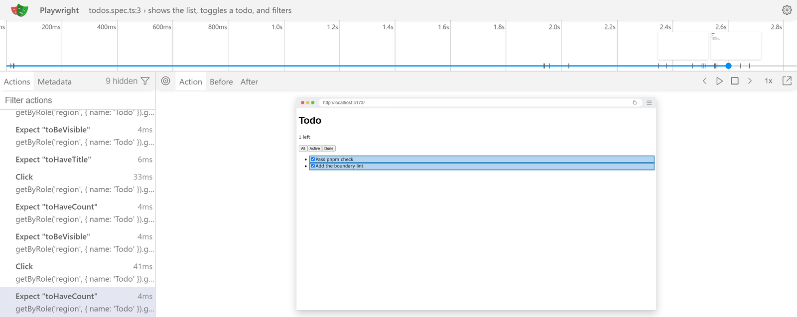
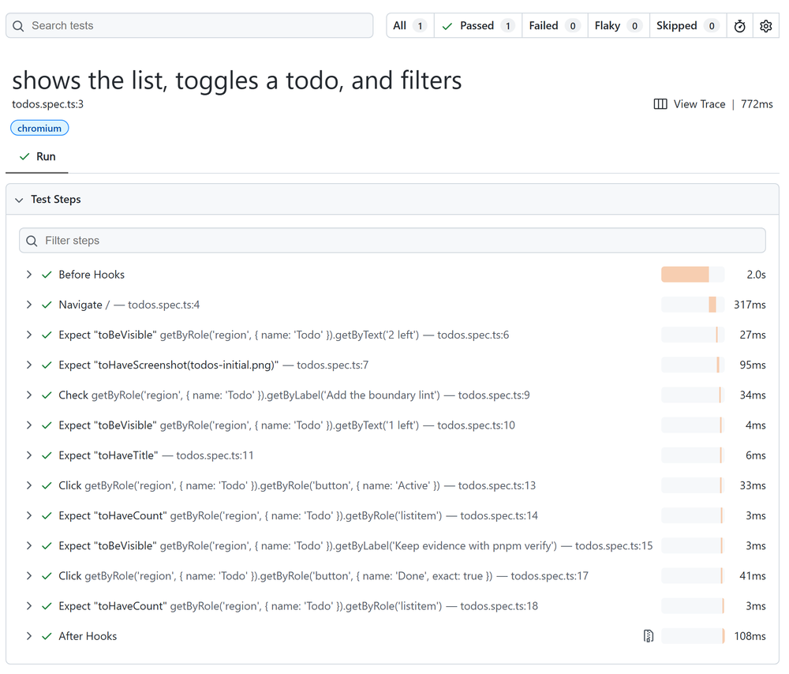

<p align="center">
  <picture>
    <source media="(prefers-color-scheme: dark)" srcset="docs/assets/logo-dark.svg">
    
  </picture>
</p>

<h3 align="center">Lint and verification for agent-written code.</h3>

<p align="center">
  <a href="README.md">日本語</a> ・ English
</p>

<p align="center">
  
  
  
</p>

<p align="center">
  
</p>

<table>
  <tr>
    <td colspan="2" align="center"><a href="docs/media/trace.en.png"></a></td>
  </tr>
  <tr>
    <td colspan="2" align="center"><b>Trace</b> <sub>— step through each action later, with the page, network and logs at that moment</sub></td>
  </tr>
  <tr>
    <td width="50%" align="center"></td>
    <td width="50%" align="center"><a href="docs/media/report.en.png"></a></td>
  </tr>
  <tr>
    <td align="center"><b>Video</b> <sub>— the run, recorded as is</sub></td>
    <td align="center"><b>HTML report</b> <sub>— pass or fail and time per step</sub></td>
  </tr>
</table>

<p align="center"><sub>All of this is evidence that <code>pnpm verify todos</code> leaves on every run of the <a href="examples/todo-app">todo-app</a> example. CI keeps the same evidence and posts the result and a link to it on the PR.</sub></p>

---

**bugyo** is a toolkit for handing development work to AI agents.
Instead of piling up written instructions, it shapes the codebase so that **the wrong way is stopped by lint, and every check leaves evidence behind**.

The core (feature map, verification, task ledger, gate) does not depend on any stack. The lint and dependency rules assume TypeScript. There are two templates: a React (Vite) app, and a Node library or CLI with no UI.

## Why

Three things happen when you delegate to agents. bugyo stops each of them with tooling, not prose.

| What happens | How bugyo stops it |
| --- | --- |
| Code lands in random places and styles, and the next agent copies it | Folder structure and lint rules that only let the right way through |
| "I verified it" cannot be trusted | A verify command actually runs the feature and keeps pass/fail plus evidence. A task can only be closed by `bugyo task done`, which runs check, test, and verify itself |
| The same kind of mistake keeps coming back | Instead of another note, add a lint rule that bans it and says what to use instead. Rework is recorded by kind, and the second occurrence fails `bugyo gate` until it becomes a rule |

## See it

**Every block comes with what to use instead.** In a project that turns on the `useEffect` and `fetch` bans (the `react-vite` template does), an agent that writes them gets this back:

```
 1:17  error  'useEffect' import from 'react' is restricted. [bugyo:use-effect] useEffect is not allowed in product code. Fetch data with useXxxQuery in features/*/api, and use a dedicated hook in src/shared/lib for subscriptions and timers. If no such hook exists, add one to src/shared/lib.  no-restricted-imports
10:3   error  Unexpected use of 'fetch'. [bugyo:fetch] Do not call fetch directly. Use the client in src/shared/api and validate the response with a schema.  no-restricted-globals
```

(Two entries taken from the output for the deliberately broken test file `packages/lint-react/test/fixture/src/features/a/ui/Bad.tsx`, Rule messages and the CLI output are in English by default; set `"locale": "ja"` in `.bugyo/config.json` for Japanese.)

**Verification returns pass/fail and where the evidence is, nothing more.** No long logs eating the agent's context.

```
$ pnpm verify todos
PASS todos  steps: docs/features/todos.md
evidence: artifacts/test-results (video, screenshots, traces), artifacts/report/index.html
```

The two lines say: the steps to check are in `docs/features/todos.md`, and the evidence (video, screenshots, trace, HTML report) is under `artifacts/`.

## What it does

- **Structure** — `src/app`, `src/features/<id>/{ui,api,model,index.ts}`, `src/shared/{ui,lib,api}`. Other code may import a feature only through its `index.ts`. The `node-lib` template uses `src/features/<id>/{model,index.ts}` only.
- **Lint** — parts and bans you pick and combine. The parts are `common` (no `any`, no type assertions, no unexplained `eslint-disable`) and `structure` (feature boundaries, `model/` stays pure). Bans are added one at a time: no comments, `fetch` only in `shared/api`, `useEffect` only in `shared/lib`, no timers in feature UI. Your own bans are written in the same shape with `defineBan`. The React part and bans live in a separate package, `@bugyo/lint-react`; projects without React install `@bugyo/lint` only.
- **Dependency rules** — no cycles, no reaching into another feature's internals, `shared` depends on nothing above it.
- **Feature map** — one `docs/features/<id>.md` per feature with four required sections: what exists, how to get there, how to operate and check it, and where it tends to lie. Tests fail when a feature, its spec, or its map entry is missing.
- **Verification** — `bugyo verify <id>` runs the feature's check and reports pass/fail plus where the evidence is. By default it runs the Playwright spec and keeps video, screenshots, and a trace; with `"runner": "command"` in `.bugyo/config.json` it runs any command per feature and keeps its output.
- **Task ledger and gate** — one file per task in `.bugyo/tasks/`. `bugyo task done` collects the evidence the task type needs and closes the task only when it passes. A task flipped to done by hand fails `bugyo task lint` inside `pnpm check`. `bugyo gate` decides whether to widen what agents may do, from rework, first-pass closes, and repeated mistakes. `bugyo stats` shows the record per task type, model, and harness.
- **Scaffold** — `bugyo init --template <name>` and `bugyo new feature` create projects and features that already follow these rules.
- **Gradual adoption** — `bugyo doctor` counts violations per ban before you adopt the rules, and `bugyo baseline save` records the current violations as a baseline. `bugyo baseline check` fails whenever a ban's count goes up or down, so the baseline can only shrink.

Details are in [docs/foundation.md](docs/foundation.md) and [docs/tasks.md](docs/tasks.md) (Japanese).

## What is in the box

| Path | Contents |
| --- | --- |
| [packages/lint](packages/lint) — `@bugyo/lint` | ESLint flat config (the common and structure parts, the comment and `fetch` bans, `defineBan` for your own bans), dependency-cruiser rules, a strict tsconfig. No React dependency |
| [packages/lint-react](packages/lint-react) — `@bugyo/lint-react` | The React part (react-hooks) and bans (where `useEffect` may live, no timers in UI) added on top of `@bugyo/lint` |
| [packages/bugyo](packages/bugyo) — `bugyo` | CLI (`init` / `new feature` / `verify` / `task` / `mistake` / `gate`), feature map loader and consistency tests, Playwright config |
| [plugin](plugin) | Claude Code plugin (five skills, a review subagent, a hook that refuses direct edits to the files that decide completion, and a hook that runs `bugyo task lint` before the agent stops) |
| [examples/todo-app](examples/todo-app) | A React (Vite) sample; the source of `bugyo init --template react-vite` (the default) |
| [examples/node-lib](examples/node-lib) | A TypeScript library / CLI sample with no UI and no React, Vite, or Playwright; the source of `bugyo init --template node-lib` |

## Getting started

bugyo is not on npm, so build it from this repository. You need Node 24 or later and pnpm 11.

```bash
pnpm install
```

```bash
pnpm --filter bugyo pack && pnpm --filter @bugyo/lint pack && pnpm --filter @bugyo/lint-react pack
```

Pick a template when you create the project. The default is `react-vite`.

| Template | What you get | How verify works |
| --- | --- | --- |
| `react-vite` | A React + Vite app. Lint uses the common, structure, and React (`@bugyo/lint-react`) parts, plus the comment, `fetch`, `useEffect`, and UI-timer bans | Drives the UI with Playwright and keeps video, screenshots, and a trace |
| `node-lib` | A TypeScript library / CLI with no UI, run directly by Node's type stripping. Lint uses the `common` and `structure` parts plus the comment and `fetch` bans only; `@bugyo/lint-react` is not installed | Runs each feature's check script with `node` and keeps its output |

```bash
node packages/bugyo/bin/bugyo.js init ../my-app --template node-lib
```

In the generated `my-app/package.json`, point `bugyo` and `@bugyo/lint` (and `@bugyo/lint-react` for `react-vite`) at the tarballs you just built using `file:` paths. Then run the following (for `react-vite`, also run `pnpm exec playwright install chromium`):

```bash
cd ../my-app && pnpm install
```

```bash
pnpm check && pnpm test && pnpm verify --all
```

To add a feature, run `pnpm exec bugyo new feature <id>`. What it generates depends on the template. Adding bugyo to an existing project is covered in [docs/adopt.md](docs/adopt.md), and every option in [docs/foundation.md](docs/foundation.md) (both in Japanese).

## Language

The detailed docs and the plugin skills are written in Japanese. Rule messages and the CLI output are in English by default. This page is the English entry point.

## Developing this repository

```bash
pnpm install
```

```bash
pnpm check && pnpm test && pnpm verify
```

```bash
pnpm validate-plugin
```

- The `packages/lint` and `packages/lint-react` tests run every rule against deliberately broken files (the `.ts`-only `packages/lint/test/fixture-node` and the React `packages/lint-react/test/fixture`) and check that each one reports an error
- The `packages/bugyo` tests check what `new feature` and `init` generate for both templates, and how `verify` and the task ledger behave (including that what should be refused is refused) on a fixture that uses neither React nor Playwright (`test/fixtures/plain`)
- TypeScript is pinned to 6.0

### Publishing to npm

Bump `version` in `packages/lint`, `packages/lint-react`, and `packages/bugyo` to the same version, merge to main, then tag that commit `v<version>` and push the tag. GitHub Actions (`.github/workflows/publish.yml`) checks that the tag matches the versions, runs `pnpm check` and `pnpm test`, and publishes `@bugyo/lint`, `@bugyo/lint-react`, and `bugyo` in that order with provenance. Versions already on npm are skipped.

```bash
git tag v0.1.0 && git push origin v0.1.0
```

Publishing needs the npm organization `bugyo` and a repository secret `NPM_TOKEN` (an npm token that can publish to that organization and to `bugyo`).

## License

[MIT](LICENSE)
